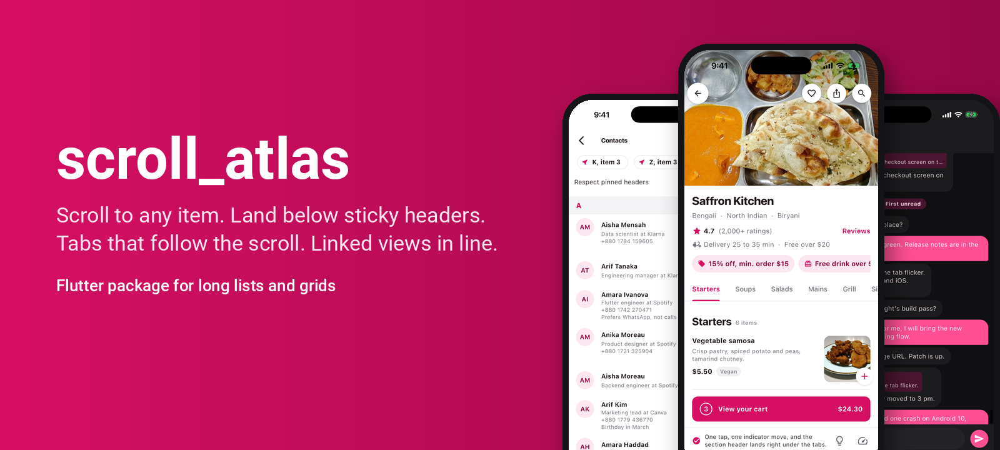

<!--
  Images: GitHub renders the relative paths below. pub.dev does not reliably resolve
  relative image paths, so before `dart pub publish` replace each
  `assets/...` image path with the absolute raw URL, for example:
  https://raw.githubusercontent.com/Rayhan12/scroll_atlas/main/assets/hero.png
-->

<p align="center">
  
</p>

<h1 align="center">scroll_atlas</h1>

<p align="center">
  Precise scrolling for Flutter. Jump to any index, in any sliver, below any pinned header.
</p>

<p align="center">
  <a href="https://pub.dev/packages/scroll_atlas"></a>
  <a href="https://pub.dev/packages/scroll_atlas/score"></a>
  <a href="https://pub.dev/packages/scroll_atlas/score"></a>
  <a href="LICENSE"></a>
  <!-- <a href="https://github.com/Rayhan12/scroll_atlas/actions/workflows/ci.yaml"></a> -->
</p>

> **Status: pre-release, in development.** The API below is the planned 1.0 API. Nothing is published yet, and the pub badges stay empty until the first release.

## Features

- **Scroll to any index.** `jumpTo` and `animateTo` land exactly on items that have never been built, with variable heights, in lists of any length.
- **Works with other slivers.** Put index-addressable lists anywhere in a `CustomScrollView` and target them by id, not by `BuildContext`.
- **Sticky-aware alignment.** Targets land below pinned app bars and stuck section headers by default, so they are never hidden.
- **Sticky sections.** `SliverAtlasSection` gives you sticky headers that know when they are stuck.
- **Visible items.** `positions` reports which items are on screen and how much of each.
- **Scroll-synced tabs.** `AtlasTabBar` follows the scroll and scrolls on tap, without the indicator flickering through every tab.
- **Linked scrollables.** `LinkedScrollGroup` keeps header rows, frozen columns and carousels aligned during flings.
- **Stable while content changes.** Inserting items above, or images loading above, does not move what the user is reading.
- **Drop-in migration.** `package:scroll_atlas/compat.dart` keeps the class names of `scrollable_positioned_list` and `linked_scroll_controller`.

## Install

```sh
flutter pub add scroll_atlas
```

Or in `pubspec.yaml`:

```yaml
dependencies:
  scroll_atlas: ^0.1.0
```

## Quick start

### A list you can jump around in

```dart
import 'package:flutter/material.dart';
import 'package:scroll_atlas/scroll_atlas.dart';

class Messages extends StatefulWidget {
  const Messages({super.key, required this.items});
  final List<String> items;

  @override
  State<Messages> createState() => _MessagesState();
}

class _MessagesState extends State<Messages> {
  final atlas = AtlasController();

  @override
  void dispose() {
    atlas.dispose();
    super.dispose();
  }

  @override
  Widget build(BuildContext context) {
    return Scaffold(
      appBar: AppBar(
        title: const Text('Messages'),
        actions: [
          IconButton(
            icon: const Icon(Icons.vertical_align_top),
            onPressed: () => atlas.animateTo(
              index: 0,
              duration: const Duration(milliseconds: 450),
              curve: Curves.easeOutCubic,
            ),
          ),
        ],
      ),
      body: AtlasListView.builder(
        controller: atlas,
        itemCount: widget.items.length,
        itemBuilder: (context, i) => ListTile(title: Text(widget.items[i])),
      ),
    );
  }
}

// Anywhere: atlas.jumpTo(index: 7321, alignment: 0.5);
```

### Sections with sticky headers in a CustomScrollView

```dart
AtlasScrollView(
  controller: atlas,
  slivers: [
    const SliverAppBar(pinned: true, title: Text('Contacts')),
    for (final section in sections)
      SliverAtlasSection(
        id: section.letter,
        header: (context, stuck) => LetterHeader(section.letter, raised: stuck > 0),
        sliver: SliverAtlasList.builder(
          id: 'people-${section.letter}',
          itemCount: section.people.length,
          itemBuilder: (context, i) => PersonTile(section.people[i]),
        ),
      ),
  ],
);

// Lands right below the pinned app bar and the stuck "K" header.
// Pass respectPinned: false to align to the viewport edge instead.
atlas.animateTo(
  target: AtlasTarget.item('people-K', 3),
  duration: const Duration(milliseconds: 400),
);
```

Any other sliver becomes a target when you wrap it in `AtlasAnchor`:

```dart
const AtlasAnchor(id: 'footer', sliver: SliverToBoxAdapter(child: Footer())),
// ...
atlas.jumpTo(target: const AtlasTarget.sliver('footer'));
```

### Tabs that follow the scroll

```dart
AtlasTabBar(
  controller: atlas,
  sectionIds: menu.map((s) => s.id).toList(),
  tabs: [for (final s in menu) Tab(text: s.title)],
);
```

### Linked scrollables

```dart
final group = LinkedScrollGroup();
final headerRow = group.createController();
final body = group.createController();
// Give headerRow and body to two horizontal scroll views; they now move together.
```

## Migrating from scrollable_positioned_list

**Step 1.** Swap the dependency:

```diff
 dependencies:
-  scrollable_positioned_list: ^0.3.8
+  scroll_atlas: ^0.9.0
```

**Step 2.** Change the import. Your code keeps compiling with the same class names:

```diff
-import 'package:scrollable_positioned_list/scrollable_positioned_list.dart';
+import 'package:scroll_atlas/compat.dart';
```

**Step 3 (optional).** Move to the new API screen by screen:

| scrollable_positioned_list | scroll_atlas |
|---|---|
| `ScrollablePositionedList.builder(...)` | `AtlasListView.builder(...)` |
| `ItemScrollController.jumpTo(index: i)` | `AtlasController.jumpTo(index: i)` |
| `ItemScrollController.scrollTo(index: i, duration: d)` | `AtlasController.animateTo(index: i, duration: d)` |
| `ItemPositionsListener.itemPositions` | `AtlasController.positions` |
| `ScrollOffsetController.animateScroll(offset: o, duration: d)` | `AtlasController.animateBy(offset: o, duration: d)` |

From `linked_scroll_controller`: `LinkedScrollControllerGroup` is also in `compat.dart`, and its new name is `LinkedScrollGroup` (`addAndGet()` becomes `createController()`).

## How it compares

Facts read from the pub.dev and GitHub APIs on 2026-10-28.

| Package | Latest version | Last published | Downloads (30 days) | Likes | Repository |
|---|---|---|---|---|---|
| [scrollable_positioned_list](https://pub.dev/packages/scrollable_positioned_list) | 0.3.8 | 2023-05-08 | 679,109 | 1,995 | google/flutter.widgets, archived, BSD-3-Clause |
| [linked_scroll_controller](https://pub.dev/packages/linked_scroll_controller) | 0.2.0 | 2021-05-05 | 158,099 | 335 | google/flutter.widgets, archived |
| [scroll_to_index](https://pub.dev/packages/scroll_to_index) | 3.0.1 | 2022-05-18 | 474,878 | 821 | quire-io/scroll-to-index |
| [scrollview_observer](https://pub.dev/packages/scrollview_observer) | 1.27.3 | 2026-09-14 | 137,517 | 325 | fluttercandies/flutter_scrollview_observer, MIT |
| [super_sliver_list](https://pub.dev/packages/super_sliver_list) | 0.4.1 | 2024-03-26 | 112,647 | 301 | superlistapp/super_sliver_list, MIT |
| scroll_atlas | not published | | | | MIT |

What the other packages' own docs say:

- scrollview_observer is actively maintained and covers ListView, SliverList, GridView and mixed CustomScrollViews. For items with dynamic heights it recommends a large `cacheExtent` to reduce "page turning" during a jump, in a CustomScrollView each target sliver is identified by its `BuildContext`, and the height of a pinned `SliverAppBar` at the target is returned from a callback you provide ([wiki](https://github.com/fluttercandies/flutter_scrollview_observer/wiki)).
- super_sliver_list jumps to items that are not built yet, inside slivers, and its README notes that scrollable_positioned_list cannot be combined with other slivers ([README](https://github.com/superlistapp/super_sliver_list)).

scroll_atlas aims to combine id-based targets, sticky-aware alignment, scroll-synced tabs, linked controllers and a drop-in layer for the two archived Google packages in one maintained package. Speed comparisons will appear here only after they are measured with the benchmark app on real devices, with links to the raw results.

Progress so far (headless test runs and an iOS simulator in debug mode, not real devices yet): `AtlasListView` lands every jump in one frame within 0.5 px while building at most 16 items, animates across 80,000 items without a snap at the end (last frame move 0.11 px headless, 1.73 px on the iOS simulator), and keeps the item you are reading still when 20 items are inserted above it. Across 26 sticky sections under a pinned bar, 500 of 500 jumps land in one frame with no target hidden under a header (B4, headless). Tables and raw files: [`benchmark/README.md`](benchmark/README.md).

## Example app

The `example/` app has six screens: Jump lab (100,000 items), Contacts A to Z with sticky headers, Timetable with a frozen header and column, Food menu with synced tabs, Migration before and after, and Chat with jump to reply.

## Contributing

Contributions are welcome.

1. Open an issue first for anything larger than a small fix, so we can agree on the API.
2. Fork, then create a branch from `main`.
3. Run the checks before you push:
   ```sh
   dart format --set-exit-if-changed .
   flutter analyze
   flutter test
   ```
4. Add tests for new behavior. Scroll positions are checked to within 0.5 px.
5. Open a pull request and describe how you tested it (device, Flutter version).

Bug reports are most useful with your Flutter version, the device, and a minimal reproduction.

## License

MIT. See [LICENSE](LICENSE). Copyright (c) 2026 Rayhanul Islam.

scroll_atlas is an independent implementation. It shares no code with google/flutter.widgets; the compat layer only mirrors public class and method names to ease migration.
